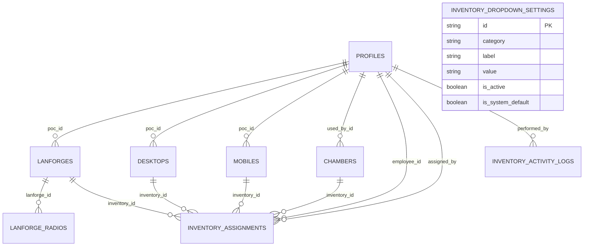

# Candela Inventory Management Platform — Database Migration Guide

## 1. Migration Execution Sequence

All migrations reside in `supabase/migrations/` and must be applied in order:

```
001_auth_profiles.sql ──► 002_inventory_schema.sql ──► 003_assignments_and_activity_schema.sql ──► 004_dropdown_settings_schema.sql
```

A master runner file is provided at `supabase/schema.sql` which includes all four migrations via `\ir`.

---

## 2. Table Dependency Graph



---

## 3. Verification Queries

After executing migrations in Supabase, verify database health by running these SQL checks:

```sql
-- 1. Check all tables exist
SELECT table_name 
FROM information_schema.tables 
WHERE table_schema = 'public'
ORDER BY table_name;
-- Expected: inventory_activity_logs, inventory_assignments, inventory_dropdown_settings,
--           lanforge_radios, lanforges, profiles, desktops, mobiles, chambers.

-- 2. Verify partial index on active assignments
SELECT indexname, indexdef 
FROM pg_indexes 
WHERE tablename = 'inventory_assignments';
-- Expected: uq_active_assignment_per_equipment (WHERE assignment_status = 'active')

-- 3. Verify atomic stored procedures exist
SELECT routine_name 
FROM information_schema.routines 
WHERE routine_schema = 'public' 
  AND routine_name IN ('fn_assign_equipment', 'fn_return_equipment', 'fn_transfer_equipment');

-- 4. Verify system dropdown defaults
SELECT category, count(*) 
FROM public.inventory_dropdown_settings 
GROUP BY category;
-- Expected: 6 categories (locations, projects, chipsets, brands, chamberTypes, ethernetSpeeds)
```
